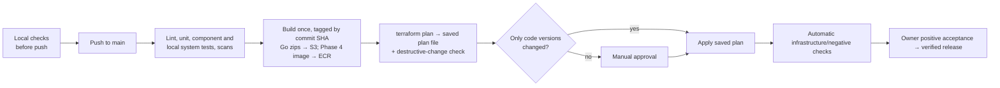

# Deployment and shared validation

[Documentation index](../README.md) · [Architecture](../architecture.md) · [Roadmap](../roadmap.md)

[DNS](#dns-and-region) · [Terraform](#terraform-conventions) · [Releases](#cicd) · [Manual setup](#steps-outside-normal-terraform-provisioning) · [Testing strategy](#validation-approach)

## Scope and status

**Status: proposed; implementation and validation are pending.** Owns DNS provisioning, Terraform conventions, environment/release workflow and shared testing strategy. Commands and code layout below describe planned implementation, not existing tooling. IAM policies live in [security](../specs/security.md).

## Required behavior and invariants

- Infrastructure and runtime artifacts must be reproducible and pinned.
- One environment uses local pre-deploy tests and owner-run positive release acceptance.
- Initial plans have no enabled webmail resources or webmail deployment prerequisites.
- The webmail deploys from its own Terraform root and state; mail-system plans never include its resources and do not need its image.
- Stateful replacements require detection and deliberate repair; code rollback does not reverse data or infrastructure.

## Design

Use Terraform with the `hashicorp/aws` provider to define:

1. DNS: the Route 53 hosted zone and all records, from the merged declarations of each module (`dns` module).
2. Required SES receiving domain identity/ownership verification and the DMARC record.
3. Inbound SES receipt rules (`aws_ses_receipt_rule_set`, `aws_ses_receipt_rule`, `aws_ses_active_receipt_rule_set`) and the declared MX record.
4. Outbound relay: `relay-smtp2go` module declaring the SMTP endpoint and sender-domain CNAMEs. The relay-agnostic `mail-outbound` module owns the active-relay SSM parameter, the empty relay credential and webhook secrets, the submission and delivery queues and the dispatcher, worker, recovery, webhook-receiver and delivery functions; `jmap-api` serves the receiver at `POST /webhooks/<relay>`. Future relays get their own `relay-*` module.
5. Separate S3 storage for permanently retained originals, disposable uploads/derived objects and indexes; encryption, lifecycle policies and least-privilege access follow the [retention contract](recovery.md#original-mail-retention).
6. SES S3-action SNS topic, restricted SNS/SQS policies, ingestion and work queues/DLQs, processing/bounce/dispatcher Lambdas and recovery schedules.
7. DynamoDB mail/security tables, transaction/change/outbox records, Streams wake-ups and PITR explicitly disabled. No backup/export storage or scheduled backup jobs are provisioned.
8. Regional REST API Gateway, common Lambda authorizer and JMAP service, with every Lambda deployed as a published version behind a `live` alias; `STREAM` integrations for API responses, EventSource and downloads, each with the integration timeout raised to the 15-minute maximum ([JMAP push](../specs/jmap.md#push)). Every integration, event-source mapping and invoke permission targets its alias explicitly.
9. Search: versioned S3 index prefix with the [search retention policy](../specs/search.md#index-pipeline), SQS wake-up queue/DLQ, indexer Lambda (reserved concurrency 1), separate search Lambda and sufficient scratch space.
10. Cognito User Pool, the initial terminal OAuth app client (redirect URIs, PKCE), and resource server with the `mail.read`, `mail.write` and `mail.submit` scopes. Add the browser app client only with Phase 4.
11. Observability and operations: explicit CloudWatch log groups with retention, the dashboard (alarms and their SNS topic only if the owner adds them; see [monitoring](monitoring.md#alarms-and-dashboard)), saved Logs Insights queries, X-Ray active tracing on every Lambda and the API Gateway stage, X-Ray sampling rules and the AWS Budgets alert.
12. **Phase 4 only:** in the main root, the webmail registration (Cognito app client, authorizer allowlist entry and JMAP CORS origin), absent while `webmail_subdomain` is unset. In the separate `infra/webmail` root, the ECR repository, the Lambda container with Web Adapter and its execution role, the webmail REST gateway, custom domain, ACM certificate, its DNS records and an optional budget ([webmail deployment](#webmail-deployment)). Neither exists initially, so both are absent from plans, deployment checks and the initial cost baseline.

### DNS and region

DNS is hosted in **Amazon Route 53** and every record is managed by Terraform. Cost is about $0.50/month for the hosted zone plus well under $0.40/month in queries at personal volume.

- **Record declarations:** every enabled module that needs DNS (`mail-inbound`, `relay-*`, `jmap-api`, `auth`, and `webmail` from Phase 4) exposes a `dns_records` output: a list of `{name, type, ttl, values, purpose}` entries. A single `dns` module owns the hosted zone and turns the merged list into `aws_route53_record`s. The exception is the separately applied webmail: `infra/webmail` writes its two records (the `webmail` CNAME and its ACM validation CNAME) into the existing zone itself, because the main root must not depend on its state; the `dns` module leaves records it does not declare alone, and names must not collide. Keeping declarations separate from Route 53 resources means records are defined in one place per feature and the DNS host could change later by replacing only the `dns` module.
- **Portable records only:** use standard record types (MX, TXT, CNAME, SRV, A/AAAA where needed); no Route 53 alias records, health checks or routing policies. Public HTTP endpoints use subdomains with plain CNAMEs for gateway custom domains, never an apex CNAME. Add `webmail.example.com` and its certificate in Phase 4. JMAP autodiscovery uses the standard SRV record `_jmap._tcp.example.com` (RFC 8620 §2.2) pointing at the JMAP host.
- **Certificates:** ACM certificates for the API custom domains use DNS validation; Terraform creates the validation records and waits for validation in the same apply.
- **Verification:** after every deploy, CI resolves every declared record through public resolvers and fails if any is missing or different ([release checks](#cicd)), which also catches a broken delegation.

**Registration and delegation:** keep the domain at its current registrar; registrar and DNS host are independent. Before delegating, copy any existing records in use into the Terraform declarations, apply, check the new zone answers correctly, then change the nameservers at the registrar to the zone's four Route 53 nameservers once, by hand. Transferring the registration to AWS is optional and not required.

**Mail records:** SES is used only to receive mail. The `mail-inbound` module declares the **inbound MX record for the SES receiving endpoint** and the required SES domain identity and TXT ownership-verification record, using the SES domain-identity API. Receiving requires ownership verification; see [SES receiving domain verification](https://docs.aws.amazon.com/ses/latest/dg/receiving-email-verification.html). SES sending DKIM and custom MAIL FROM records are unnecessary. Sending-side records (DKIM, return path, SPF) are declared by the relay module ([mail flow](../specs/mail-flow.md#design)), and a DMARC TXT record is declared explicitly.

SES inbound receipt is available only in some regions, so the region choice follows from it. The region is a deployment variable (`region`) with no default: choose any region listed among the [SES email receiving endpoints](https://docs.aws.amazon.com/general/latest/gr/ses.html). All receiving resources except S3 buckets must be in the SES region, so every project resource uses the same one. The reference deployment uses `us-east-1`; Phase 0 still has to prove receipt there on the pilot subdomain.

### Queue configuration

- **Queue settings:** `ReportBatchItemFailures` so one bad message does not retry the whole batch; visibility timeout at least six times the Lambda timeout; `maxReceiveCount` of about 5 before the dead-letter queue, which is [alarmed](monitoring.md#alarms-and-dashboard).

### Terraform conventions

- **Remote state:** store state in a dedicated, versioned and encrypted S3 bucket with S3-native locking (`use_lockfile = true`, Terraform 1.10+). A separate `bootstrap` configuration, applied by hand, creates that bucket, the GitHub OIDC provider, the CI roles and the artifact bucket ([CI identity](../specs/security.md#ci-identity)).
- **Secrets and state:** Terraform state contains every value it manages in plain form. Do not let it generate or hold relay SMTP passwords, webhook secrets or other long-lived secrets; set those out of band and store them in Secrets Manager, with Terraform creating only the empty secret and the IAM access to it. Restrict who can read the state bucket.
- **Pin versions:** pin Terraform and every provider in `required_providers` and commit `.terraform.lock.hcl`.
- **Protect data:** set `lifecycle { prevent_destroy = true }` on the hosted zone, message bucket, DynamoDB tables and Cognito User Pool. Enable S3 versioning; leave DynamoDB point-in-time recovery disabled for the current scope. The original bucket has no current/noncurrent expiration, no force-empty behavior and no original-delete IAM grants; disposable cleanup cannot target it.
- **IAM creation:** every created role and policy follows the [IAM requirements and component inventory](../specs/security.md#iam-role-requirements); include permission changes in the reviewed Terraform plan and validate both allowed and denied operations.
- **Build separately from deploy:** Terraform does not compile code. Build the Go Lambda zips in a separate step (Makefile or CI); from Phase 4, build the webmail container separately and pass its immutable ECR digest. Plans then reflect the exact deployed artifacts.
- **Layout:** a main root configuration (one [environment](#environment)) calling small modules (`dns`, `mail-store`, `mail-inbound`, `mail-outbound`, `relay-smtp2go`, `jmap-api`, `search`, `auth`, `ops`). The Phase 4 `webmail` module is called only by the separate `infra/webmail` root, with its own state key in the same state bucket. The main root exposes no active webmail resources until the webmail is registered.

### Planned code layout

```text
infra/
  bootstrap/      State bucket, GitHub OIDC provider, CI roles and permissions boundary, artifact bucket (applied by hand)
  main/           Core modules and the Phase 4 webmail registration
  webmail/        Phase 4 webmail hosting, applied separately with its own state
  agent/          Later mail agent on AgentCore, applied separately with its own state
go/
  cmd/            Lambda entry points (ingest, dispatch, index, search, jmap, push, submit, bounce, maintenance, canary) and mail-auth/mail-admin CLIs
  internal/       JMAP protocol, MIME parsing, storage, search index and text segmentation, relay interface and adapters (smtp, fake)
testdata/         Synthetic MIME corpus, recorded client sessions, search queries, fixture generator
docs/             Architecture, roadmap, topic specs, operations guides
README.md         Project overview; docs/README.md is the documentation index
AGENTS.md         Coding-task routing and repository guidance
webmail/          Phase 4: upstream/adapter version locks, Lambda Dockerfile and browser acceptance fixtures
agent/            Later: Python LangGraph agent, its Dockerfile, synthetic mailbox and evaluation sets
```

### Webmail deployment

The webmail (Phase 4, [browser hosting](../specs/clients.md#browser-hosting-and-client-safety)) is a separate deployment unit. The mail system works the same whether it exists or not, and its CLI path is the fallback when a webmail release fails.

- **Boundary:** the main root owns everything the mail API trusts: the Cognito app client, the authorizer allowlist and the CORS origin, all created by setting `webmail_subdomain`. `infra/webmail` owns the hosting. It takes the main root's `webmail` output as plain variables and looks up the hosted zone by name; it never reads the main state, and the main root never references it. Removing the registration from main stops the webmail from obtaining or using tokens even if its hosting remains.
- **First deployment:** (1) set `webmail_subdomain` in `infra/main` and apply it; (2) copy `terraform -chdir=infra/main output -json webmail` into `infra/webmail/terraform.tfvars`, initialize with `terraform init -backend-config=../backend.hcl` and apply with `image_digest` unset, which creates only the ECR repository; (3) run `make webmail-image WEBMAIL_REPO=<repository_url>`, which builds the pinned linux/arm64 image from `webmail/versions.env`, pushes it under an immutable commit tag and prints its digest; (4) set `image_digest` and apply again to create the function, `live` alias, gateway, certificate, custom domain and records.
- **Updates and rollback:** change `webmail/versions.env` (versions, commit and digests together, and `webmail_locales` in main if upstream locales changed), rebuild and apply the new digest. The plan of a release changes only the function image, version and alias. Roll back by applying a previous digest; the repository keeps the newest ten images.
- **Removal:** destroying `infra/webmail` removes the hosting only (an ECR repository with images must be emptied first); unset `webmail_subdomain` and apply main to remove the registration.
- **Cost attribution:** resources of this root carry the `Component=webmail` tag. The optional budget filters on it once that tag is activated as a cost allocation tag in Billing.

### Environment

There is **one deployed environment**, in one AWS account, serving as both production and the place where changes are verified after deploy. A personal project does not justify a second copy of DNS, Cognito and relay setup. Development happens locally against the test harness ([validation approach](deployment.md#validation-approach)), which runs every Go handler and the relay adapters against local fakes; nothing is deployed until it passes there.

The pipeline combines local pre-push checks, CI tests on every push to `main`, a destructive-change plan check, gated infrastructure changes, automatic negative/infrastructure checks and an **owner-run positive acceptance check after each deployment**. Initially use aerc plus `mail-auth`/`mail-admin` and synthetic mail; browser checks join the checklist only after webmail is enabled in Phase 4. CI receives no personal-mail token and cannot read mailbox data. Mark a release verified only after the applicable owner checklist passes. This is a release test, not an additional deployment approval gate. Phase 0 validates the real infrastructure before primary-mail cutover; later changes reach production before this check, a deliberate single-environment tradeoff.

### CI/CD



**Trunk-based development:** the owner commits directly to `main`, with no feature branches or owner pull requests. CI runs after a commit is already on `main`, so run the local check tiers before pushing. A failed check stops that commit before build and deployment; fix forward with a new commit or revert it. External contributions arrive as fork pull requests, get offline checks only and are landed on `main` by the owner after review.

**Checks on every push to `main`** (GitHub Actions, jobs filtered by changed paths) run the CI tiers of the testing strategy ([validation approach](deployment.md#validation-approach)). They must pass before the build and deployment jobs start:

- **Go:** `go vet`, `golangci-lint`, unit, fuzz-corpus, component and local system tests; build `provided.al2023` arm64 binaries.
- **Terraform:** `terraform fmt -check`, `terraform validate`, `tflint`, `checkov`, `terraform test`. The AWS-backed plan runs in the deployment pipeline below and publishes a sanitized resource/action summary in the job summary, never the raw plan or state. Saved binary/JSON plans are restricted deployment artifacts with seven-day expiry; their access is audited. Fork PRs run offline checks without credentials.
- **Security:** `gitleaks` (essential in a public repository), `govulncheck`, and `trivy` filesystem scanning of dependencies. Add webmail image/dependency scans and browser integration jobs when its module is introduced in Phase 4.

**Deployment from `main`** (after the checks pass). Deployment runs one at a time in commit order through a GitHub Actions `concurrency` group that never cancels an in-progress apply; a newer pending run supersedes older pending ones.

1. **Build once.** Go Lambda zips are uploaded to a versioned S3 artifact bucket, keyed by commit SHA. Terraform receives these versions as variables. From Phase 4, the webmail build job also pushes a pinned image to ECR and records its digest, upstream commit and adapter version in the release manifest. Initial builds require no webmail image or ECR push.
2. **Plan and check.** `terraform plan` writes a plan file. A script over `terraform show -json` fails the run if any stateful resource would be deleted or replaced: the hosted zone and the MX record, message and index buckets, DynamoDB tables, Cognito user pool, SES identity and receipt rules. This complements `prevent_destroy`, which does not catch moves or renames. Reject disabling original-bucket versioning, enabling force-empty/expiration, or adding original-object/version deletion grants as well.
3. **Apply.** If the plan only changes deployed Lambda code versions/aliases (including a webmail image digest after Phase 4), it is applied automatically under the code-deploy role. Any other change, including enabling webmail or modifying DNS, requires manual approval through a protected GitHub environment. The job applies the **saved plan file**, so what was approved is exactly what runs.
4. **Automatic post-deploy checks** without mailbox access, after allowing for API deployment propagation (about a minute in Phase 0) by retrying within a bounded window: DNS declarations resolve correctly; unauthenticated discovery returns the documented `401`; negative auth cases fail on every route; active SES rules match the deployment; all triggers/integrations point to the expected aliases; and the mail-loop check below passes. A failure reverts code aliases together and reports infrastructure actions that require separate repair.
5. **Mail-loop check:** CI invokes only the canary entry point, which generates and stores a fresh random nonce, send time and deployment version. It sends through the normal durable relay workflow to reserved `canary@`. Ingestion validates the exact outstanding nonce/version and deadline, marks that run received conditionally, emits a heartbeat and omits the synthetic message from the active mailbox. Its original raw S3 object remains permanently retained; it is not a cleanup exception. Replay, unrelated mail or an earlier deployment's heartbeat cannot satisfy the check. Read only the run's pass/fail control record through the canary API, not raw mail or mailbox items. This proves the transport path, not persistent mailbox/JMAP correctness.
6. **Deliverability check,** only when the plan changed DNS records or relay resources: send through the active relay to an external checker and confirm DKIM, SPF and DMARC pass ([validation approach](deployment.md#validation-approach)).
7. **Positive acceptance:** initially the owner logs in through `mail-auth`, uses aerc and runs local `mail-admin acceptance` with the owner's OAuth token. Receive a uniquely marked synthetic mail, confirm get/query/changes and alias routing, upload/download an attachment, move/mark/search it after indexing, send and verify Sent/submission state, then delete the fixture from the active mailbox while retaining its original S3 object. Verify token refresh; use the protocol harness for push/reconnect features the CLI does not expose, and two independent CLI sessions for shared state. Once webmail is enabled, add its browser-specific gate ([clients](../specs/clients.md#design)) and CLI/browser shared-state checks. The helper returns a content-free release result; no owner token or mailbox response reaches CI. A failed applicable check leaves the release unverified and triggers rollback/repair. Missing deferred browser checks do not block a core release.

**No scheduled synthetic tests:** keep the original preference for push/deployment-triggered checks. Between deployments, real-traffic alarms cannot distinguish a quiet mailbox from an upstream outage that emits no events; this policy leaves a documented detection gap. One-minute work-recovery sweeps and garbage collection are scheduled operational jobs, not synthetic tests. Monitor their completion/age so a stopped maintenance path is visible.

**Rollback:** publish every Lambda version behind `live`; retain the prior release manifest and revert the related aliases as one release, with triggers/integrations pinned to those aliases. CI records the manifest used, and the next Terraform plan reconciles emergency alias drift. Retain immutable artifacts and, after Phase 4, prior webmail images/digests referenced by retained releases. Alias rollback does not reverse DNS, IAM, receipt rules, relay settings or data changes: inspect the saved plan and use their documented repair steps. Schema/data-format changes ship in compatible stages (read both formats, migrate, then remove old support in a later release), with rehearsed synthetic backfills. Incompatible data restoration uses [recovery](recovery.md#design) and outbound pause, never a blind replay of send attempts.

**Access:**

- GitHub OIDC with no stored AWS keys: separate plan, code-deploy and gated infrastructure-deploy roles (see [CI identity](../specs/security.md#ci-identity)).
- Pull requests from forks get no AWS access: use the `pull_request` trigger, never `pull_request_target`.
- Pin third-party actions to commit SHAs; Renovate (or Dependabot) updates actions, Go modules and Terraform providers.
- Protect `main` with a repository ruleset: only the owner may push, and force pushes and branch deletion are blocked. Do not require status checks on `main`, because that rule blocks direct pushes; local pre-push checks and the pipeline's check jobs, which run before build and deploy, take that role.
- Changes to `infra/bootstrap/` are applied by hand by the owner, never by CI.

**Other workflows:**

- **CLI releases:** `goreleaser` on version tags publishes `mail-auth` binaries for macOS and Linux to GitHub Releases.
- **Drift:** there is no scheduled drift check. Every deployment plan shows drift from manual changes; fork PRs run offline checks. Deployment plans are applied only after the destructive-change check.

The later [mail agent](../specs/agent.md#deployment-and-operations) adds its own build, test and evaluation jobs to this pipeline.

### Steps outside normal Terraform provisioning

- Apply the `bootstrap` configuration with a [short-lived owner admin session](../specs/security.md#ci-identity), migrate its state into the new bucket, and set the role ARNs and region as GitHub repository variables; create the `production` and `production-gated` GitHub environments.
- Delegate the domain's nameservers at the registrar to the Route 53 hosted zone, once, after the zone is populated and verified.
- Sign up for SMTP2GO, add and verify the sender domain, configure the bounce/complaint webhook, and store the SMTP credentials and webhook secret in Secrets Manager.
- Create the personal Cognito user with a temporary password (no invitation message) and set the real password at first login.
- Enroll independent recovery methods and run Phase 0 client/transport checks using aerc. In Phase 4, validate the webmail's browser login configuration; the pinned OAuth-only client needs no session secret, and no VM management key is required. Activate the `Component` cost allocation tag if the webmail budget is used.
- Rehearse [recovery](recovery.md#failure-handling) and the owner positive acceptance checklist before directing primary mail here.

Do not accidentally delete the hosted zone, message bucket, DynamoDB content or Cognito User Pool during routine `terraform apply` runs. Follow the original-retention policy; additional backup infrastructure is out of scope.

## Failure handling

Use the coordinated alias rollback and staged schema procedure in CI/CD above. Failed positive acceptance leaves a release unverified. Repair infrastructure separately from aliases. For incompatible data restoration, pause outbound delivery and follow [recovery](recovery.md#failure-handling).

## Acceptance checks

- `terraform test` per module: encryption and versioning on, `prevent_destroy` present, Lambdas published behind the `live` alias, no NAT gateway.
- `terraform test` verifies no additional backup resources/jobs and disabled DynamoDB PITR.
- Unit tests for the destructive-change check against sample plan JSON files, including original-bucket expiration/versioning changes and accidental original-delete grants.
- **DNS declarations:** `terraform test` asserts the merged record set (MX, SPF, DKIM, DMARC, SRV, ACM validation) is complete, uses only portable record types and has no apex CNAME.
- **Deliverability:** in deployments that change DNS records or relay resources, send through the active relay to an external checker and confirm DKIM, SPF and DMARC pass.
- **Release failure injection:** break successful-token validation and normal mailbox persistence while preserving negative-auth/canary behavior. Positive acceptance must fail. Delayed prior canaries cannot pass a new run. Test coordinated alias rollback and document infrastructure changes it cannot undo.

Run topic acceptance checks listed in the [roadmap](../roadmap.md#release-gates). Regional availability, pinned runtime/provider integration and actual deployed behavior must be proven during Phase 0; browser packaging is deferred to Phase 4.

## Validation approach

Tests are organized around JMAP consistency, MIME handling, authorization and the relay boundary. The local harness is also the development environment. Deployed CI checks need no mailbox access; the owner separately runs positive acceptance with synthetic mail and normal OAuth credentials ([release workflow](#cicd)).

### Tiers

| Tier | Where / when | Scope |
| --- | --- | --- |
| Unit and fuzz | Locally before push and every CI run, seconds | Parsers, algorithms, error classification |
| Component | Locally before push and every CI run, ~1 minute | One Lambda handler against DynamoDB Local and an S3-compatible store (`testcontainers-go`) |
| Local system | Locally before push and every CI run, minutes | All Go handlers wired together in one local HTTP harness: ingest → JMAP → push → submit → bounce, with recorded SES inbound events, the `fake` relay adapter and a local SMTP sink (e.g. Mailpit) |
| Interoperability | Every CI run (available replays); owner checklist per release | aerc first; browser fixtures and checks added in Phase 4 |
| Post-deploy CI | Deployed environment, every deployment | Infrastructure/negative-auth checks, nonce-bound transport canary and conditional deliverability checks |
| Positive acceptance | Owner-run after every deployment; CLI slice in Phase 0 | aerc + protocol helper: auth/refresh, persistent synthetic mail, get/query/changes, blobs, search, submission and safe cleanup; add browser acceptance only when deployed |
| Recovery/scale | Before primary cutover and after relevant storage changes | Isolated synthetic rebuilds with/without metadata, deletion/GC races, 50,000-message search benchmark and index-version accounting |

Handlers are invoked directly with recorded SES S3-action SNS envelopes, SQS/Streams events and SMTP2GO webhook payloads locally, rather than through LocalStack. Real AWS acceptance covers behavior absent from these fakes.

### Test data rules

- Only synthetic or public-domain mail in the repository; never real messages. `gitleaks` does not catch personal content, so this is a review rule.
- A fixture generator in `testdata/` produces large synthetic mailboxes for property tests, search evaluation and local development.

**Priority if time is short:** the authorization matrix, sync property tests and MIME corpus come first, since they guard against leaking or corrupting mail; recorded client replays next.

