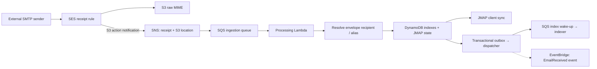
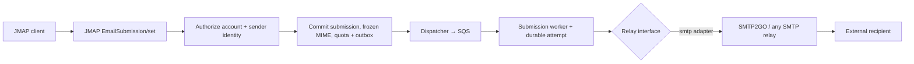

# Mail receipt and submission

[Documentation index](../README.md) · [Architecture](../architecture.md) · [Roadmap](../roadmap.md)

## Scope and status

**Status: proposed; implementation and validation are pending.** Owns SMTP envelope routing, accepted-message disposition, bounded MIME processing, relay delivery and bounce handling. Transaction mechanics live in [storage and sync](storage-sync.md).

## Required behavior and invariants

- SMTP envelope recipients determine routing, including BCC and aliases.
- Accepted mail is durably retained or quarantined when processing cannot finish safely.
- Relay acceptance and final destination delivery are different outcomes.
- Once external acceptance becomes uncertain, automatic resend stops.
- Display sanitization belongs to [clients](clients.md); the backend preserves raw MIME.

## Design

### Alias policy

**Alias policy:** Catch-all is disabled initially. One Terraform alias declaration generates both SES recipient conditions and the runtime registry; enable receiving only for declared active aliases, including the reserved canary address. Base aliases also allow their `+tag` variants, matching SES receipt-rule behavior; retain the exact delivered address and map replies to the base sending identity. Use one matching delivery rule followed by a stop action to avoid duplicate deliveries across overlapping rules. Unmatched recipients must be rejected during the SMTP transaction; verify this with the selected SES rule set before cutover. If SES has already accepted mail during a registry/deployment race, retain it in Quarantine and alert rather than silently discarding it or sending a later bounce. Alias changes are infrastructure changes and follow the gated deployment path.

### Inbound email



Important implementation details:

- Publish the inbound SES MX record ([DNS](../operations/deployment.md#dns-and-region)).
- The SES S3 action stores MIME and publishes its receipt notification to SNS; subscribe SQS with producer/account restrictions and notification delivery failure handling. Persist the full required envelope recipient set, matched local recipients, envelope sender, receipt timestamp and SES verdicts with the S3 location. MIME headers are not the authority for envelope routing. Use [the SES receipt notification schema](https://docs.aws.amazon.com/ses/latest/dg/receiving-email-notifications-contents.html); the separate full-message SNS action and bare S3 object events are not this path.
- Store raw MIME durably under SSE-S3 or an explicitly configured bucket SSE-KMS key and least-privilege IAM. Do not accidentally select SES's optional client-side encryption mode when configuring ordinary S3 server-side encryption. Keep version IDs in blob/receipt references; the S3-action notification carries only the object key, so ingestion resolves the version of that unique key before recording it ([evidence](../evidence/phase0-ses-receiving.md#findings)). SES delivers originals into the dedicated permanent-original bucket; parsed/extracted data goes to disposable storage. The [original retention policy](../operations/recovery.md#original-mail-retention) also applies to failed ingestion and canaries.
- Configure retries, a dead-letter queue, and idempotent ingestion: events may be delivered more than once (see [durable receipt/outbox handling](storage-sync.md#idempotency-and-durable-work)).
- Parse MIME parts, attachments, subject, sender, dates and message identifiers, retaining both message headers and SMTP envelope metadata. Decode all text to UTF-8 from its declared charset and record the detected language.
- Resolve aliases against the registry, apply the disposition policy below, and commit metadata, receipt marker, JMAP state and outbox work in the [storage transaction contract](storage-sync.md#dynamodb-storage-and-consistency-contract).
- Publish an `EmailReceived` event (account id, email id, mailbox ids and stable event id; no content) through the committed outbox after successful ingestion. The outbox dispatcher publishes it to the `s3mail-events` EventBridge bus (source `s3mail.mail`, detail-type `EmailReceived`, detail `{version: 1, accountId, eventId, emailId, mailboxIds}`), at least once and in batches of up to ten; a failed publish keeps the outbox entry for the next drain or sweep. The bus has no rule of its own, so without a consumer the event is dropped and mail never waits on one. From agent phase A1 the [mail agent](agent.md) adds its own rule and triggers triage from it ([future extensions](../architecture.md#future-extension-points)).

### Recipient and processing policy

Enable SES spam/virus scanning. Virus failures and unknown/error verdicts go to Quarantine; spam failures go to Junk; DMARC failures requesting quarantine/reject also go to Quarantine after acceptance. Other messages enter their configured mailbox, normally Inbox. Preserve verdicts and raw MIME; do not generate post-acceptance bounces to an untrusted sender. SES supplies verdicts without applying this disposition automatically. See [SES receiving behavior](https://docs.aws.amazon.com/ses/latest/dg/receiving-email-concepts.html).

Accepted inbound mail may be up to SES's S3-action limit of 40 MB including headers. Bound the parser to 30 MIME nesting levels, 1,000 parts, 256 KiB of headers, 100 header-address entries per stored projection, 64 MiB total decoded output and a 60-second processing deadline. Preserve overflowing fields/parts in raw MIME and mark metadata incomplete rather than pretending the projection is complete. Exceeding a work/structure limit produces a minimal Quarantine Email plus a diagnostic code and retained raw blob; it is not retried forever as a poison message. Transient infrastructure failures retry through SQS and DLQ. Manual owner reprocessing uses a new parser version without duplicating the receipt. These are backend processing limits; client HTML rendering responsibilities are in [clients](clients.md#browser-hosting-and-client-safety).

### Outbound email



Submission creation authorizes the account, sender identity, envelope, referenced Email and all requested success hooks. It freezes immutable MIME/envelope material in S3, then commits the submission, its relay configuration version, quota reservation and dispatch outbox. An acknowledged creation means durable acceptance for dispatch, not confirmed destination delivery. Honor `onSuccessUpdateEmail`/`onSuccessDestroyEmail` and their implicit `Email/set` response when creation succeeds; do not create an unconditional second Sent copy. The durable send snapshot pins its blobs even if a hook destroys the original Email. Failed hook mutations are reported according to JMAP without undoing accepted submission creation. Keep identities synchronized with active aliases and require relay domain verification.

The worker conditionally claims an attempt with a random owner token, a two-minute lease and a 60-second SMTP deadline. It records the transition to `handoff_started` before any operation that could transmit DATA. A one-minute maintenance sweep re-enqueues undispatched work and recovers expired attempts. A duplicate delivery seeing a live lease exits without changing the attempt. Expiry before handoff is retryable; expiry after handoff is **acceptance unknown** and raises an alarm without automatic resend. A worker may complete only its own attempt; reconciliation appends a resolution instead of rewriting attempt history. An owner command displays the evidence and can explicitly authorize a new attempt after checking the relay. Sending can be globally paused during incident recovery.

Internal states distinguish queued, active, relay-accepted, retryable-not-accepted, permanently rejected, acceptance-unknown and canceled. Map them to standard `undoStatus`, recipient `deliveryStatus` and DSN fields; do not add new enum values to standard JMAP properties. Cancellation is permitted only before handoff using the same conditional attempt guard. Use a declared project capability for diagnostic attempt details if clients need them. Record relay acceptance separately from final recipient delivery.

**Client retry boundary:** At-most-once automatic handoff applies to one durable submission, not to two independent creates. JMAP creation IDs are request-scoped. After a lost response, reference clients must reconcile submissions for the known Email before retrying; never deduplicate solely by content or Message-ID because intentional resends are valid. Document any remaining client ambiguity in its supported configuration. See [JMAP submission semantics](https://www.rfc-editor.org/rfc/rfc8621.html#section-7.5).

### Outbound relay interface

Inbound mail always uses SES; **SES is not used for sending**, so its sandbox and production-access process do not apply. Outbound delivery is **relay-agnostic**: the submission path depends on a small Go interface, and each relay is an adapter selected by configuration. Nothing outside the adapters knows which relay is in use.

```go
type Relay interface {
    // The result distinguishes accepted, definitely-not-accepted temporary,
    // permanent rejection and acceptance-unknown, with per-recipient results.
    // IDs unavailable through this transport remain absent.
    Submit(ctx context.Context, env Envelope, rawMIME io.Reader) SubmitResult
}
```

Responsibilities split as follows:

| Concern | Shared submission code | Relay adapter |
| --- | --- | --- |
| Authorization, sender identity, frozen send copy, JMAP success hooks | Yes | No |
| Daily and monthly quota enforcement | Atomic reservation per submission/attempt | Declares accounting unit, period/timezone and limits |
| Delivery | No | Yes |
| Failure reporting | Records normalized `DeliveryEvent`s on the `EmailSubmission` (`deliveryStatus`) | Translates the relay's bounce/complaint signals into `DeliveryEvent`s |
| DNS records | No | Each relay module declares its records; the `dns` module publishes them in Route 53 ([architecture](../architecture.md#component-responsibilities)) |
| Credentials | No | Read from Secrets Manager at runtime |

Adapters:

| Adapter | Status | Notes |
| --- | --- | --- |
| `smtp`, configured for SMTP2GO | **Planned; initial production relay** | Authenticated SMTP submission (587 with required STARTTLS or 465 TLS), certificate/hostname verification required. Provider limits and recipient accounting are verified during Phase 0 and stored as configuration |
| `fake` | Planned, tests only | In-memory adapter used by the local test harness; also proves the interface is not shaped around SMTP |
| SES API, other providers | Not implemented | Can be added later as new adapters without changes to JMAP code or stored mail |

SMTP2GO specifics:

- **Failure reporting:** SMTP2GO webhooks → dedicated gateway route requiring a rotated bearer shared secret from Secrets Manager → SQS → bounce worker. Persist before returning success. Configure the provider's supported Authorization header; see [SMTP2GO webhook configuration](https://support.smtp2go.com/hc/en-gb/articles/223087967-Webhooks). Retain failed-event redelivery and normalized per-recipient status. Correlate using a generated submission header/provider id, never just the sender-supplied Message-ID. Unverified inbound DSNs cannot by themselves change authoritative delivery status; reconcile them with relay evidence.
- **DNS:** SMTP2GO sender-domain CNAMEs (DKIM, return path and the link domain SMTP2GO requires for verification; open and click tracking stay disabled in the account), declared by the `relay-smtp2go` module and published in Route 53. The sender domain itself is added once in the SMTP2GO dashboard or API (no maintained Terraform provider assumed).
- **`Message-ID`:** require preservation in the initial SMTP2GO adapter and verify at external destinations. Generic SMTP cannot portably retrieve a relay-rewritten header. A provider that rewrites it needs a provider-specific reconciliation capability before it is supported; a relay queue ID is not a Message-ID.
- **Tracking:** open and click tracking stay disabled for the sending user.

Design rules:

- **Relay selection is configuration:** the active relay is one value (e.g. an SSM parameter) read by the submission path. With one adapter in production this is `smtp2go`, but adding and switching to another relay requires no change outside its adapter and DNS module.
- **Credentials:** SMTP credentials and the webhook secret live in Secrets Manager; Lambdas read them at runtime. No credentials in source or IaC state outputs.
- **DMARC through DKIM:** one DMARC record; each relay signs with DKIM aligned to the domain, so DMARC passes regardless of the relay's return path.
- **Keep the inbound MX at SES** whatever relay sends.
- **Respect relay caps:** reserve both daily and monthly capacity atomically before accepting a submission, using the verified provider accounting unit (including recipient fan-out) and reset timezone. A reservation is consumed on relay acceptance or unknown acceptance and released only after proven non-acceptance/cancellation. Safe retries reuse or renew the reservation in the correct period without double accounting. Concurrent requests cannot exceed a cap. Reject exhausted capacity with an appropriate JMAP error and explanation.
- **Recipient and MIME policy:** collect all `RCPT TO` replies. If any recipient is rejected, abort with RSET/connection close **before DATA**, record each reply and classify the whole attempt as not accepted; do not deliver to a subset initially. Once DATA may have been accepted, a timeout is unknown, not a temporary rejection. Strip Bcc from transmitted MIME while keeping the private local representation. The adapter must not fall back to plaintext SMTP. See [SMTP transaction behavior](https://www.rfc-editor.org/rfc/rfc5321.html#section-3.3).
- **Suppression lists:** SMTP2GO may suppress addresses after hard bounces or complaints. The adapter must surface a suppressed recipient as a permanent failure on the submission, and the owner must be able to see and clear suppressions; verify SMTP2GO's behavior and API before relying on it.

### Webhook idempotency

- **Relay webhooks:** deduplicate by provider event ID, or a documented canonical composite if the provider lacks one; never use the provider email ID alone for all recipient/status events. Keep deduplication markers at least 30 days and apply monotonic recipient-state transitions so older/replayed events cannot undo a terminal result. Persist and acknowledge events even if correlation must wait for the worker's relay ID.

Receipt, change, outbox and attempt records have distinct purposes and retention. They are not replaced by one short-lived generic processed-ID cache.

### Current outbound implementation

What is deployed (`go/internal/send`, `go/internal/relay`, `go/internal/dispatch`, `infra/modules/mail-outbound`, `infra/modules/relay-smtp2go`) and where it is narrower than the design above:

- **Frozen send material:** a submission pins the Email's exact original version (`composed/` or `imported/`); originals are never deleted, so no separate copy is written. Bcc is stripped when the worker reads it.
- **Attempts:** queued → claimed under a random owner token and a two-minute lease → `handoff_started`, committed in the SMTP adapter immediately before `DATA` → accepted, rejected or unknown. Proven non-acceptance retries after 1, 5, 15 and 60 minutes, reusing the reservation, and becomes rejected after five attempts. Attempt records are append-only (`ATTEMPT#<submission>#<attempt>#<record>`); `mail-admin submission ID` shows them and `mail-admin resolve ID accepted|rejected|retry` appends the owner's resolution.
- **Pause:** the `/s3mail/relay` SSM parameter must name the configured relay (`smtp2go`); it is created as `paused` and Terraform ignores later changes. Paused workers claim nothing; work recovery re-enqueues due submissions after the pause ends.
- **Quota:** daily and monthly counters per relay (`QUOTA#smtp2go#day#…`, `…#month#…`), reserved in the creation commit, one unit per envelope recipient by default. Defaults are 200/day and 1,000/month in UTC (`relay_quota` in the root module), the limits of SMTP2GO's free plan. SMTP2GO counts the month from the account's own cycle, not the calendar month, which its dashboard shows; a send beyond the relay's own limit is refused by the relay.
- **SMTP adapter:** 587 with required STARTTLS (465 implicit TLS also accepted), verified certificates, `AUTH PLAIN`, 60-second transaction deadline.
- **Delivery reports:** SMTP2GO posts JSON webhooks to `POST /webhooks/smtp2go` on the API with `Authorization: Bearer <secret>` (Secrets Manager `s3mail/relay/smtp2go-webhook`; the current and previous versions are accepted during rotation). The receiver has no table or mail access: it checks the secret and persists the body on the delivery queue before answering 200. The delivery worker maps `delivered` and `spam` to `yes`, hard `bounce` and `reject` (for example a suppressed recipient) to `no`, soft `bounce` to `queued`, and ignores the other events. It correlates by SMTP2GO's `email_id`, the queue id in the final `250 OK id=…` reply, which the worker records as `RELAYID#smtp2go#<id>`, never by Message-ID. It deduplicates by an `EVENT#smtp2go#<hash>` marker over the event's identifying fields (SMTP2GO documents no per-event id) committed with the change, and a recipient's `yes` or `no` is never changed again. Reports that cannot be parsed or correlated within about 30 minutes go to the delivery DLQ.
- **Tracing:** a send is one X-Ray trace from `EmailSubmission/set` through the outbox, dispatcher, submission queue and worker to an `SMTP submit` span ([monitoring](../operations/monitoring.md#current-implementation)).
- **Suppressions:** a report for a suppressed recipient (`reject`) or a hard bounce sets `no`. The owner views and clears SMTP2GO's suppression list in the SMTP2GO dashboard; s3mail holds no SMTP2GO API key, and JMAP does not show suppressions.
- **Delivery markers** expire through the table TTL 90 days after they are written; a later replay cannot undo a final state.
- **Not yet:** alarms for DLQs and unknown acceptance (the owner chose none; the worker and sweep log `outcome: acceptance_unknown`); a diagnostic attempt capability. The pause check logs the parameter value it read whenever it pauses sending.

## Failure handling

The inbound policy above distinguishes bounded-parser quarantine from transient queue retries. The outbound lease and handoff protocol above distinguishes proven non-acceptance from unknown acceptance. Owner reconciliation is required before retrying an uncertain send. [Queue configuration](../operations/deployment.md#queue-configuration) and [monitoring](../operations/monitoring.md) cover retries, DLQs and alarms.

## Acceptance checks

- **Golden corpus** of synthetic `.eml` files with expected parsed output: nested multipart, inline images, malformed boundaries, legacy charsets (GBK, Big5, Shift_JIS, ISO-2022-JP, EUC-KR, windows-1252), RFC 2047 headers, forwarded messages, DSNs, and large attachments.
- **Fuzzing** (Go native fuzzing) of the MIME parser, header decoding and the JMAP request parser: no panics, and parse → serialize → parse is stable.
- **Alias/disposition routing:** known/unknown/+tag/BCC/multiple local recipients and nonce-bound canary; real SMTP unknown-recipient rejection; registry deployment races; spam, virus, DMARC and unknown verdict handling. Parser size/depth/part/time bounds must yield durable Quarantine records, while transient infrastructure failures reach retry/DLQ without blocking unrelated work.
- **Relay conformance:** distinguish accepted, proven retryable non-acceptance, permanent rejection and unknown acceptance. Inject failures before dispatch, before DATA, during DATA/final reply and after acceptance/before result storage. Test one accepted/one rejected RCPT abort before DATA, Bcc stripping, required TLS, Message-ID preservation, concurrent quota reservations, period rollover and explicit owner reconciliation.
- **Bounce normalization:** authenticate and durably queue webhooks; test correlation-before-worker-result, multiple recipients, duplicate/out-of-order terminal events and deduplication expiry. Forged inbound DSNs cannot establish delivery status without provider evidence.
