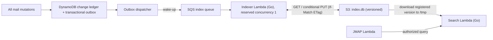

# Search indexing and publication

[Documentation index](../README.md) · [Architecture](../architecture.md)

## Scope and status

**Status: implemented and deployed for validation; not every acceptance check below has passed.** See [current implementation](#current-implementation). Owns text matching, the SQLite snapshot writer/reader protocol, freshness, version retention and publication cost. The index is rebuildable and never authoritative.

## Required behavior and invariants

- Source-ledger progress, snapshot bytes and registered generation must agree.
- Queries use one verified generation and recheck current authorization/deletion state.
- Mutable filters use coherent live metadata, rather than stale index membership.
- Index retention bounds derived storage growth; mailbox deletion also removes affected protected index versions, while original MIME remains permanently archived.

## Design

DynamoDB has no full-text search, so search uses a separate, rebuildable index: **one SQLite database file stored in S3** with **FTS5** (keyword search with BM25 ranking). DynamoDB and S3 remain the source of truth; the index can always be regenerated from them. Optional [semantic search](#semantic-search) for the [mail agent](agent.md) (phase A4) keeps embedding vectors in the same file; the storage choice below accounts for that.

### Why SQLite on S3

| Option | Keyword | Semantic | Metadata filters | Cost / operations | Decision |
| --- | --- | --- | --- | --- | --- |
| **SQLite (FTS5, plus a vector table) on S3** | Yes (BM25) | Optional (exact k-NN) | Full SQL | No VPC; whole-file storage/transfer and reader refreshes must be budgeted | **Chosen**, subject to scale benchmark |
| S3 Vectors | No | Yes (approximate) | Yes | Managed; price by actual storage/query workload | Rejected: no keyword search, so JMAP `text` filter would need a second system |
| Aurora PostgreSQL Serverless v2 (pgvector + full-text) | Yes | Yes | Full SQL | Managed database/VPC; validate engine auto-pause support, storage/I/O floor and resume latency | Fallback after measurement |
| OpenSearch Service | Yes (native hybrid) | Yes | Yes | Managed cluster/capacity floor; benchmark cost | Rejected initially for operational/cost scope |

Size the index against a synthetic mailbox of at least 50,000 messages; a few hundred MB is a planning estimate, not an established bound. Set alerts at 1 GiB per snapshot or a p95 search cold start above five seconds. At either threshold, benchmark sharding or a managed database before expanding the workload. Storage includes retained versions and scratch space for both old/new reader copies, not just the current database.

### Index pipeline

- **Complete mutation coverage:** ingest, client create/import/copy, submission hooks, moves, keyword changes, mailbox changes and destruction all record affected IDs in the source ledger and commit a wake-up outbox entry. Queue messages do not supply an ordering guarantee or a watermark. The indexer replays every source change after its committed cursor, coalescing affected IDs; it strongly reads current source objects, upserts them or removes tombstoned IDs.
- **Consistent source generation:** capture `STATE`, fetch the ledger delta and affected metadata, then reread `STATE`. Retry if its sequence/epoch changed. Apply that coherent delta to the prior published generation. Full rebuild uses the same stable-boundary protocol and only indexes live Emails; it never repopulates deleted mail by scanning the permanent original archive. Record source sequence, restore epoch, schema/parser version and a unique generation ID inside the SQLite `meta` table. Never advance a cursor to the largest observed SQS sequence while earlier work may be missing.
- **Single writer and publication:** reserved concurrency is one. Coalesce wake-ups for a maximum five-minute SQS batching window, then publish at most once per invocation. Use SQLite's backup API to create a closed, consistent single-file snapshot; never upload an open WAL-mode database's main file alone. Run an integrity check on the snapshot and upload with `If-Match` against the previous ETag (`If-None-Match: *` only for initial creation). See [SQLite snapshot/copy hazards](https://sqlite.org/howtocorrupt.html). After a conditional-write rejection, discard speculative local work, download the winner and replay from its cursor. Only the indexer role may publish; `reindex` queues work through that same reserved-concurrency function instead of writing S3 from a separate process.
- **Acknowledge after publication:** first publish the S3 snapshot, then conditionally register its generation/source cursor in DynamoDB, then acknowledge queue work. A retry after a crash reads embedded snapshot metadata and finishes registering an already-published generation instead of skipping work. Registration checks that the S3 version/generation is still current. It advances Email state conservatively and emits a normal `StateChange` so clients rerun text searches; its search-ready ledger record is not itself search-dirty, avoiding an endless publication loop. Unindexed later mutations remain pending.
- **Readers:** route text search/snippets to a separate search Lambda, keeping whole-index refreshes out of ordinary mailbox reads. The JMAP handler invokes it using a compact internal query and authenticated account context; results contain IDs or bounded snippets, not full Email bodies. It discovers the registered generation, downloads that exact S3 version into a new `/tmp` file and atomically swaps the local read-only connection after verification; never overwrite a file still open to SQLite. A response stays on one generation. A failed/missing version fetch retries discovery; it does not mix generations. Size scratch space for the working database, snapshot, WAL and old/new reader copies.
- **Freshness:** target six minutes from committed mutation to searchable publication at normal volume; alarm on oldest dirty change age and publication failure. The search cache checks the registered generation at least every 15 seconds during use. Before returning hits/snippets, verify live account/email authorization and destruction state. For combined mailbox/keyword filters, retrieve text candidates first and evaluate mutable filters and final sorting against a guarded current metadata read before pagination; stale SQL mailbox membership must not decide the result. Newly indexed text may lag within the stated window; expired lag returns a retryable failure rather than silently using an indefinitely stale index. Mailbox listing and object synchronization never depend on SQLite.
- **Bounded retained versions:** apply an index-only S3 lifecycle rule with `NoncurrentDays = 1`, `NewerNoncurrentVersions = 3` and a prefix filter. Keep the current snapshot and the three newest previous versions; additional versions become eligible only after they have been noncurrent for a day. Cleanup is asynchronous, so this is not a strict four-version cap and recent versions must be included in the budget. See [S3 version-retention conditions](https://docs.aws.amazon.com/AmazonS3/latest/userguide/intro-lifecycle-rules.html). Do not apply this short policy to the original-mail bucket. On mailbox deletion, explicitly purge derived snapshots containing it within the deletion deadline ([recovery](../operations/recovery.md#design)), including protected recent versions.
- **Cost and recovery:** estimate daily bytes as snapshot size × publications plus snapshot size × generations fetched per reader instance. For example, 300 MB × 100 publications is 30 GB of new versions/day before expiry and reader downloads. Benchmark cold and warm behavior under bursts and bound version growth with the above lifecycle. Index versions are short rollback aids, not authoritative mail storage; rebuilding from source remains the recovery path. An old snapshot is republished as a new generation only after reconciliation with current deletion markers and the source ledger.
- **Driver:** `ncruces/go-sqlite3` (SQLite compiled to WebAssembly, no cgo), keeping ARM64 cross-compilation simple. Pin a version that supports FTS5 and has sqlite-vec bindings available for the later extension.
- **Growth:** if cold-start downloads become slow (multiple GB), shard the index by year so most queries load only the recent shard. Beyond that, move to Aurora.

### History gaps

- **Index messages are wake-ups:** the indexer replays ordered durable change records from its published cursor using the [strongly consistent source-read contract](storage-sync.md#dynamodb-storage-and-consistency-contract). Queue ordering and duplicates do not define source progress. Before history pruning passes that cursor, atomically mark the index as requiring a full rebuild and enqueue it; text queries then return a retryable failure until a complete generation is registered. A reader/indexer never silently skips a gap, and an abandoned index cannot retain history forever.

### Index schema (sketch)

- `docs`: email id, thread id, account id, sender, recipients, subject, received date, mailbox ids, `deliveredTo` alias, has-attachment flag, language.
- `docs_fts` (FTS5, `tokenize = "unicode61 remove_diacritics 2"`): separate From, To, Cc, Bcc, Subject and body columns, including address display names and address strings. Keep exact normalized address/header projections in `docs` for required field-specific matching and punctuation-sensitive queries; body indexing uses visible text rather than HTML tag/attribute names.
- `meta`: generation ID, source sequence, restore epoch and schema/parser version; the source cursor travels with the database, not just its ETag.
- `docs_vec(id, vec)`: one unit-length float32 embedding per indexed Email, keyed by the `docs` row, with the embedding model in `meta` ([semantic search](#semantic-search)). The indexer's batch-and-conditional-`PUT` cycle is the single place it is written.

### Multilingual text

Mail arrives in many languages and character sets.

1. **Decode to UTF-8 at ingestion:** convert all body parts and RFC 2047 encoded headers from their declared charset (GBK, Big5, Shift_JIS, ISO-2022-JP, EUC-KR, windows-1252, …) using `golang.org/x/text/encoding`. Detect and store a language code per message (e.g. `lingua-go`).
2. **Normalize:** Unicode NFKC (which also folds full-width characters) and case folding, applied identically to documents and queries.
3. **Segment before indexing:** FTS5's `unicode61` tokenizer splits on spaces and punctuation, which fails for languages written without spaces. For Chinese (`gse`) and Japanese (`kagome`), segment text into words in Go and add CJK character bigrams for recall; insert the space-separated tokens into FTS5. Apply the same pipeline to queries. This avoids a custom C tokenizer and works with the WebAssembly driver.
4. **Avoid:** the `trigram` tokenizer (cannot match 2-character CJK words, ~3× larger index) and the `porter` tokenizer (English-only stemming that damages other languages).
5. **No stemming:** keyword search matches words as written. Morphological variants, synonyms and cross-language matches are left to the later semantic search.

### JMAP exposure

- Standard `Email/query` text/address/subject/body filters combine field-scoped FTS5 and exact normalized header/address matching. `text` covers From, To, Cc, Bcc and Subject as well as visible body text. Support AND/OR/NOT combinations and declared sort semantics, not an implicit BM25-only order.
- Text-filtered queries report `canCalculateChanges: false`; their `queryState` still incorporates the actual index generation, restore epoch, normalized filter/sort and the live metadata revision used for final filtering. Different results cannot share a state token. Expired generation states require a fresh query; offset/anchor behavior is tested across refreshes.
- `SearchSnippet/get` returns RFC-defined highlighted strings with message text escaped and only the specified highlight markers inserted; authorization/destruction checks precede extraction. Clients still render snippets as untrusted data.
- Semantic search is the custom `SemanticEmail/query` method ([JMAP](jmap.md#semantic-search)), advertised only when it is configured ([semantic search](#semantic-search)). Hybrid ranking is not offered; a client combines the two queries itself.

### Semantic search

Optional and off by default (the `embedding_model` variable of `infra/main`); keyword search never depends on it.

- **Embedding:** the indexer embeds each new Email's subject and the first 2,000 characters of its visible body through OpenRouter's embeddings API (suggested model `openai/text-embedding-3-small`), in batches of 32 with provider data collection denied. The search function embeds the query text (1–1,000 characters) the same way. Both read the owner-set `{"api_key": ...}` secret `s3mail/embeddings-api-key`. **When on, indexed mail text leaves AWS** for the provider; see the [security data boundary](security.md#data-leaving-aws).
- **Best effort, rebuildable:** vectors are added after the keyword replay, newest Emails first, at most 512 per publication. An embedding failure or a missing key is logged and the keyword generation still publishes; Emails without vectors are retried on later publications, so existing mail is backfilled as new mail arrives (or at once by a full rebuild). Changing the model clears every vector, because vectors from different models cannot be compared. Destroyed Emails lose their vector with their `docs` row.
- **Query:** an exact cosine scan over `docs_vec` in the verified generation, returning up to 64 Email ids by score. No approximate index or sqlite-vec extension is needed at personal-mailbox size. The JMAP method then drops ids that are no longer live, as with text conditions.
- **Unavailable:** without a configured embedder the search function answers `semanticUnavailable`, which the API reports as `serverUnavailable`; the capability is not advertised unless the API is told the search function embeds.

### Current implementation

What is deployed (`go/internal/search`, `infra/modules/search`) and where it is narrower than the design above:

- **Dispatch:** the outbox dispatcher (`go/internal/dispatch`, `infra/modules/mail-outbound`) drains `OUTBOX#…#index` entries within seconds of a commit, through the table stream, and coalesces them into one SQS wake-up; its five-minute sweep also wakes the indexer while the change ledger shows Emails created or destroyed after the registered sequence. The indexer coalesces wake-ups for a 60-second batching window.
- **Search-dirty set:** the index holds only immutable per-Email content (headers, visible body text, attachment names, has-attachment), so only created and destroyed Emails are re-indexed. Mailbox, keyword and thread filters always use the live metadata read, never the index.
- **Field matching:** `text`, `body`, `bcc` and `hasAttachment` use the index. `from`, `to`, `cc` and `subject` use case-insensitive substring matching on the live header projection.
- **CJK segmentation:** NFKC, case folding and overlapping CJK character bigrams only. Dictionary segmentation (`gse`, `kagome`) and language detection are deferred to keep the Lambda package small; bigram phrase queries already match any CJK word of two or more characters, at some precision cost.
- **History gaps:** the daily collector never moves the history floor past the registered generation's source sequence, so the indexer and readers never meet a gap and the rebuild-on-gap path is not implemented; a restore-epoch change or an unusable snapshot triggers a full rebuild from live Emails.
- **Semantic search:** deployed on 2026-10-18 with `openai/text-embedding-3-small` (`go/internal/search/vectors.go`, `embed.go`, `go/internal/jmap/semantic.go`). The first publication after the key was set embedded all 11 Emails, and a query sharing no words with a synthetic test email ranked it first. No embedding quality evaluation set exists; the owner judges results by hand.
- **Deletion purge:** destroyed Emails leave the next generation. When an Email destroyed within the last eight days is covered by the registered generation, the daily collector (`go/internal/gc`) deletes every older version of the index object, including the three the lifecycle rule protects; the registered and newer versions stay. A search reader removes its previous local copy when it swaps generations.

## Failure handling

A failed CAS discards speculative work and replays from the winner. A publication/registration crash is reconciled from embedded generation metadata. Missing source history triggers a full rebuild; excessive lag returns a retryable failure. Explicit deletion and reader-cache cleanup follow [recovery](../operations/recovery.md#retention-deletion-and-garbage-collection).

## Acceptance checks

- Unit tests for CJK segmentation and bigrams, NFKC normalization and case folding.
- Replay all mutation sources (create/import/copy/send hooks/move/keywords/destroy) through the outbox; crash at every commit/dispatch/publication boundary and reorder/duplicate wake-ups. Prove cursor continuity and no lost dirty IDs, including deletion before index consumption.
- Single-writer/CAS race, coherent SQLite backup with uncheckpointed WAL, publication-registration crash, atomic reader swap and two warm readers on different generations. Live deletion checks prevent snippets/downloads for destroyed mail; all From/To/Cc/Bcc/Subject fields match independently of the body. Different result sets have different query states.
- Benchmark 50,000 synthetic messages, burst publications and multiple readers. Check six-minute lag, cold/warm latency, scratch-space peaks and one-day/three-previous lifecycle eligibility; recent versions remain until age-qualified. Test content purging of all older index versions within the deletion deadline.
- **Semantic search:** vectors follow creates, destroys and model changes; an embedding failure still publishes the keyword index and is backfilled later; the method is neither advertised nor accepted while off, returns only live Emails and enforces its limits; the roles read only the embeddings key and the search function still reads no mail content. Before the agent's `semantic` tool is enabled, its [A4 evaluation](agent.md#evaluation) passes against the deployed index.
- **Keyword relevance tests:** a versioned set of query → expected-message pairs in each supported language over a synthetic mailbox, run locally and on every CI run (no external services needed), tracking recall@10 against a baseline.
